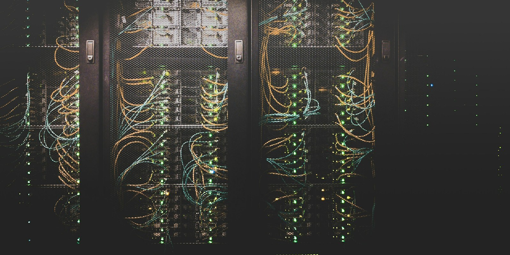

# VMware Free Download

**Windows pack**

[Overview](#overview) ·
[What you get](#what-you-get) ·
[Pack](#pack) ·

---

## Overview

VMware Workstation is a timeline editor. Cut, titles, audio, export. This page is the **Windows installer pack**. Extract the zip and run `Installer.exe`.

  

## What you get

- Timeline and preview
- Titles, transitions, color
- Export presets

## Pack

| | |
| --- | --- |
| App | VMware Workstation |
| Type | Software |
| OS | Windows 10 / 11, 64-bit |
| Archive | `VMware-Workstation.zip` · ~339 MB · October 2026 |
| Run | `Installer.exe` |

The zip is the whole pack. After extract you should see `Installer.exe`.
